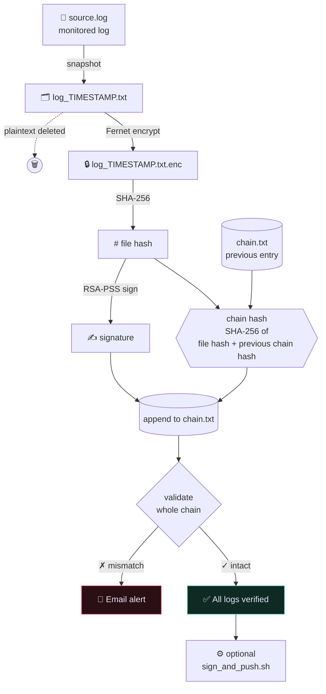

<div align="center">



<br/>

**Logs are the first thing an attacker edits.**<br/>
LogSec_IDC turns every log snapshot into an encrypted, hash-chained, RSA-signed record,<br/>
so a single changed byte breaks the chain and sends an alert.

<br/>


-0d1526?style=flat-square&labelColor=070b14&color=0d1526)


<sub>
<a href="#-how-it-works">How it works</a> &nbsp;·&nbsp;
<a href="#-quickstart">Quickstart</a> &nbsp;·&nbsp;
<a href="#-anatomy-of-a-chain-entry">Chain anatomy</a> &nbsp;·&nbsp;
<a href="#-what-gets-caught">What gets caught</a> &nbsp;·&nbsp;
<a href="#-configuration">Configuration</a> &nbsp;·&nbsp;
<a href="#-hardening-checklist">Hardening</a>
</sub>

</div>

<br/>

## ◆ The idea in one line

```
log  ──▶  encrypt  ──▶  hash  ──▶  link to previous  ──▶  sign  ──▶  verify everything  ──▶  alert on mismatch
```

Every run of `log_chain.py` captures a snapshot of your log file, seals it, and appends it to a cryptographic chain. Every block depends on the one before it, so rewriting history means forging every block that follows **and** the RSA signature on each one.

<br/>

## ◇ How it works



<table>
<tr>
<td width="20%" align="center"><b>01</b><br/><sub>SNAPSHOT</sub></td>
<td>Copies the target log to <code>logs/log_YYYY-MM-DD_HH-MM-SS.txt</code>.</td>
</tr>
<tr>
<td align="center"><b>02</b><br/><sub>ENCRYPT</sub></td>
<td>Seals it with a <b>Fernet</b> symmetric key (<code>secret.key</code>, created on first run with <code>0600</code> permissions) and deletes the plaintext copy.</td>
</tr>
<tr>
<td align="center"><b>03</b><br/><sub>CHAIN</sub></td>
<td>Hashes the encrypted file with <b>SHA-256</b>, then combines it with the previous entry's chain hash. The first entry chains to <code>GENESIS</code>.</td>
</tr>
<tr>
<td align="center"><b>04</b><br/><sub>SIGN</sub></td>
<td>Signs the file hash with a <b>2048-bit RSA</b> private key using <b>PSS padding</b>. Keys are generated automatically if missing.</td>
</tr>
<tr>
<td align="center"><b>05</b><br/><sub>VERIFY</sub></td>
<td>Walks <code>chain.txt</code> end to end, recomputing each hash and checking each signature against <code>public_key.pem</code>.</td>
</tr>
<tr>
<td align="center"><b>06</b><br/><sub>ALERT</sub></td>
<td>On any mismatch, sends <b>"⚠ Log Tampering Detected!"</b> by email over Gmail SMTP (SSL, port 465).</td>
</tr>
<tr>
<td align="center"><b>07</b><br/><sub>HOOK</sub></td>
<td>If an executable <code>sign_and_push.sh</code> exists, runs it, for example to ship the chain off-box.</td>
</tr>
</table>

<br/>

## ⚡ Quickstart

> [!NOTE]
> The script uses fixed paths under **`~/log_project`**. Clone or copy the `log_project` folder there before you run it.

```bash
# 1 · get the code into place
git clone https://github.com/Advithrai/LogSec_IDC.git
cp -r LogSec_IDC/log_project ~/log_project
cd ~/log_project

# 2 · one dependency
pip install -r ../LogSec_IDC/requirements.txt

# 2b · (optional) email alerts: add your Gmail App Password
cp ../LogSec_IDC/.env.example .env && nano .env

# 3 · seal a snapshot, extend the chain, verify
python3 log_chain.py

# 4 · verify only (no new snapshot)
python3 log_chain.py validate
```

<details>
<summary><b>▸ Sample run</b></summary>
<br/>

```console
$ python3 log_chain.py
[*] RSA key pair generated.
[+] Encrypted -> /home/user/log_project/logs/log_2025-11-10_11-40-48.txt.enc
[+] Chain updated -> 746f13dc2dde1c04d3ca8c7d8abcb33826d8773f9b0670a09f95b1e04fcb6971
[+] All logs verified OK with valid RSA signatures.

$ python3 log_chain.py validate
[+] All logs verified OK with valid RSA signatures.
```

And after someone edits a sealed file:

```console
$ python3 log_chain.py validate
[+] Email alert sent successfully!
[!] ⚠ Tampering or signature invalid -> /home/user/log_project/logs/log_2025-11-09_18-02-33.txt.enc
```

</details>

<details>
<summary><b>▸ Run it on a schedule (cron)</b></summary>
<br/>

Seal a snapshot every 15 minutes:

```cron
*/15 * * * * /usr/bin/python3 $HOME/log_project/log_chain.py >> $HOME/log_project/run.log 2>&1
```

Add it with `crontab -e`.

</details>

<details>
<summary><b>▸ Read a sealed snapshot back</b></summary>
<br/>

```bash
cd ~/log_project
python3 -c "from log_chain import decrypt_logfile; \
decrypt_logfile('logs/log_2025-11-10_11-40-48.txt.enc', 'restored.log')"
```

</details>

<br/>

## ⛓ Anatomy of a chain entry

Each line in `chain.txt` is one sealed block, written as three fields separated by ` : `:

```
/home/advith/log_project/logs/log_2025-11-06_16-15-15.txt.enc : c11ffe30…c8b241 : 4d4c525e…2fb4b40
└──────────────────── encrypted snapshot ───────────────────┘   └─ chain hash ─┘   └─ RSA sig ─┘
```

| Field | What it is | Computed as |
|:--|:--|:--|
| **Snapshot path** | Location of the encrypted log | `logs/log_<timestamp>.txt.enc` |
| **Chain hash** | Ties this block to every block before it | `SHA-256( SHA-256(file) + previous_chain_hash )` |
| **Signature** | Shows the holder of the private key created the block | `RSA-PSS-SHA256( SHA-256(file) )`, hex-encoded |

<br/>

## 🎯 What gets caught

| If someone… | The chain hash | The signature | Result |
|:--|:--:|:--:|:--|
| Edits a byte inside a sealed `.enc` file | ✗ | ✗ | 🚨 alert |
| Replaces a snapshot with a different one | ✗ | ✗ | 🚨 alert |
| Rewrites a chain hash in `chain.txt` | ✗ | — | 🚨 alert |
| Swaps in a forged signature | — | ✗ | 🚨 alert |
| Deletes a line from the middle of the chain | ✗ | — | 🚨 alert |
| Deletes a sealed snapshot file | missing | — | 🚨 alert |
| Corrupts a line's format | malformed | — | 🚨 alert |

<br/>

## 🗂 Project structure

```
LogSec_IDC/
├── README.md
├── requirements.txt
├── .env.example            ✉ template for email-alert credentials
├── .gitignore              🚫 keeps keys, .env and generated logs out of git
├── assets/banner.svg
└── log_project/
    ├── log_chain.py        ◆ the whole engine: keys, encryption, chaining, validation, alerts
    └── source.log          ◇ sample source log (point LOGSEC_SOURCE_LOG at a real one)
```

Created on first run and **never committed** (see `.gitignore`):

```
~/log_project/
    ├── chain.txt           ⛓ the append-only chain ledger
    ├── logs/               🔒 encrypted snapshots  (*.txt.enc)
    ├── secret.key          🔑 Fernet key
    ├── private_key.pem     🔑 RSA signing key
    ├── public_key.pem      🔓 RSA verification key
    └── .env                ✉ your email credentials
```

<br/>

## ⚙ Configuration

All settings are constants at the top of `log_chain.py`:

| Constant | Default | Purpose |
|:--|:--|:--|
| `PROJECT_DIR` | `~/log_project` | Root folder for everything |
| `LOGSEC_SOURCE_LOG` (env) | `~/log_project/source.log` | **The log you want to protect.** Set it in `.env`, e.g. `/var/log/auth.log` |
| `LOG_DIR` | `logs/` | Where encrypted snapshots go |
| `CHAIN_FILE` | `chain.txt` | The chain ledger |
| `KEY_FILE` | `secret.key` | Fernet encryption key |
| `PRIVATE_KEY_FILE` / `PUBLIC_KEY_FILE` | `*.pem` | RSA key pair |
| `POST_HOOK` | `sign_and_push.sh` | Optional script run after each successful cycle |

**Email alerts** read their credentials from environment variables, or from `~/log_project/.env`. Nothing secret lives in the code.

| Variable | Purpose |
|:--|:--|
| `LOGSEC_EMAIL_SENDER` | Gmail address that sends the alert |
| `LOGSEC_EMAIL_PASSWORD` | A Gmail [App Password](https://support.google.com/accounts/answer/185833), not your account password |
| `LOGSEC_EMAIL_RECEIVER` | Where alerts go (defaults to the sender) |

If they aren't set, the alert is printed to the terminal instead of emailed.

<br/>

## 🛡 Hardening checklist

Steps that take this from a proof of concept to something you can deploy:

- [x] **Secrets out of the source.** Email credentials come from environment variables or `.env`.
- [x] **Private keys out of git.** `.gitignore` excludes `secret.key`, `*.pem`, `.env` and generated logs.
- [x] **Verify the first block too.** Validation starts from `GENESIS`, so every entry's hash and signature are checked.
- [x] **Detect deleted snapshots.** A missing `.enc` file raises an alert.
- [ ] **Separate the keys from the logs.** An attacker who controls `~/log_project` holds both. Keep `private_key.pem` on another host or in an HSM/KMS, and leave only `public_key.pem` on the verifying machine.
- [ ] **Ship the chain off-box.** Use `sign_and_push.sh` to push `chain.txt` to a remote or write-once store, so deleting the whole ledger doesn't go unnoticed.
- [ ] **Configurable paths.** Accept `--log-file` / `--project-dir` flags instead of fixed constants.

<br/>

<div align="center">

<sub>Built with Python and the <a href="https://cryptography.io">cryptography</a> library · made by <a href="https://github.com/Advithrai">@Advithrai</a></sub>

<br/>


</div>
